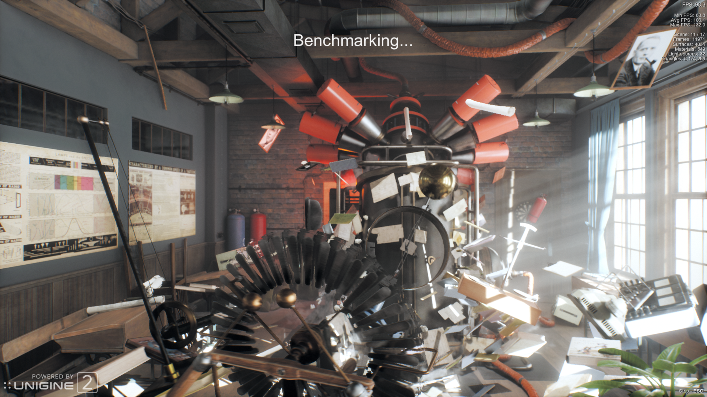

# loophole

Windows VMs that share the host's AMD GPU at near-native speed. The guest runs RADV and builds
real command buffers for the GPU. The host only manages memory, submissions and fences, through
QEMU and virglrenderer's amdgpu native context. Frames reach the host compositor as dma-bufs,
without copies.

## Requirements

You need an AMD Radeon graphics card running on Linux's `amdgpu` driver. Nothing is passed
through: your desktop keeps using the card while your VMs share it. With more than one card, VMs
use the first.

The host needs Linux 6.13 or newer, the first release that lets KVM map the card's memory into a
VM. loophole also needs its patched QEMU and virglrenderer (`nix/qemu`, `nix/virglrenderer`),
which the Nix package builds for you.

In your BIOS, turn on SVM (AMD CPUs) or VT-x (Intel CPUs). To hand whole devices to a VM, such as
an NVMe drive or a USB controller, turn on the IOMMU as well: AMD-Vi or VT-d.

You will also need a Windows 11 or Windows 10 installation ISO.

| Tested GPU | Architecture | Status |
| --- | --- | --- |
| Radeon RX 9070 XT | RDNA 4 | Works |

Other cards haven't been tested yet.

With Nix, `nix run .` opens the app. `loophole check` tells you what your machine is missing.

## Benchmarks

Loophole running Unigine Superposition 1.1, 1920 × 1080, Extreme shaders and
vsync off, on a Radeon RX 9070 XT. 

| Host (106.1 FPS) | Windows Guest (99.5 FPS) |
| --- | --- |
|  |  |

## NixOS module

```nix
{
  imports = [ loophole.nixosModules.default ];
  programs.loophole = {
    enable = true;
    users = [ "alice" ];

    # Optional, for passing host hardware to VMs.
    blockDevices = [ "nvme-Samsung_SSD_990_PRO_2TB_S7KHNJ0X123456X" ];
    usbDevices = [ "046d:c52b" ];

    vfio = {
      enable = true;
      devices = [ "0000:0b:00.0" ];
    };

    hugepages = {
      size = "1G";
      count = 16;
    };
  };
}
```

`users` get the `kvm` and `render` groups. `vfio` turns on the IOMMU, gives the listed PCI devices
to vfio-pci at boot and lifts the users' locked-memory limit. `blockDevices` and `usbDevices` give
the users access to those disks and devices, and `hugepages` reserves a pool at boot.

A VM joins the LAN through a TAP device on a bridge, both set up in your NixOS config:

```nix
networking = {
    bridges.br0.interfaces = [ "enp5s0" "tap-win11" ];
    interfaces.tap-win11 = {
        virtual = true;
        virtualType = "tap";
        virtualOwner = "alice";
    };
};
```
